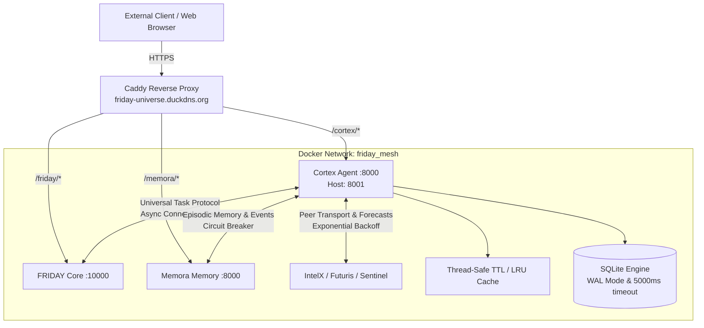

# CORTEX — Autonomous Web Operations Intelligence

> **Role in the FRIDAY Universe:** Cortex is the high-order cognitive reasoning, task decomposition, and logic execution specialist. It ingests, interprets, and acts on structured signals from the web — visitor journeys, conversion patterns, lead scoring, A/B experiments, and security events — decomposing complex operational goals into governed, audited actions.

**Production Gateway:** `https://friday-universe.duckdns.org/cortex/*`  
**Internal Docker Mesh:** `http://cortex:8000` (network: `friday_mesh`)  
**Host Port:** `8001` | **Container Port:** `8000`

---

## Topology & Architecture



All inter-agent calls use Docker internal DNS (`http://friday:10000`, `http://memora:8000`, etc.) within the private `friday_mesh` network. Public URLs are strictly prohibited inside the mesh.

---

## API Specification

### Authentication

All operator endpoints require a JWT Bearer token or the `X-Cortex-Api-Key` / `X-Friday-Api-Key` header.  
Public ingestion endpoints accept a provisioned site API key (`X-Api-Key`).

### Standardized Error Envelope

All API errors return a consistent, structured envelope:

```json
{
  "error": "HTTP_400_BAD_REQUEST",
  "message": "Field 'goal' is required",
  "detail": "Field 'goal' is required",
  "success": false
}
```

### Core Probes & Diagnostics

#### `GET /health`
Liveness probe. Used by Docker `HEALTHCHECK` and edge reverse proxies.

```bash
curl https://friday-universe.duckdns.org/cortex/health
```
```json
{
  "status": "healthy",
  "service": "cortex",
  "version": "2.1.0",
  "evidence_class": "process_liveness",
  "observed_at": "2026-10-14T16:00:00.000000+00:00"
}
```

#### `GET /ready` (or `GET /health/ready`)
Readiness probe. Verifies database connectivity and essential dependency health.

```bash
curl https://friday-universe.duckdns.org/cortex/ready
```
```json
{
  "status": "ready",
  "service": "cortex",
  "database": "connected",
  "observed_at": "2026-10-14T16:00:00.000000+00:00"
}
```

#### `GET /status`
Operational state and telemetry diagnostic probe.

```bash
curl https://friday-universe.duckdns.org/cortex/status
```
```json
{
  "status": "operational",
  "service": "cortex",
  "version": "2.1.0",
  "uptime_seconds": 3600.5,
  "observed_at": "2026-10-14T16:00:00.000000+00:00"
}
```

#### `GET /v1/health`
Versioned health check including environment metadata.

```bash
curl https://friday-universe.duckdns.org/cortex/v1/health
```
```json
{
  "status": "ok",
  "service": "cortex",
  "evidence_class": "process_liveness",
  "observed_at": "2026-10-14T16:00:00.000000+00:00",
  "environment": "production"
}
```

#### `POST /plan`
Cognitive reasoning engine endpoint. Decomposes high-level objectives into capability-mapped, sequential execution plans.

```bash
curl -X POST https://friday-universe.duckdns.org/cortex/plan \
  -H "X-Friday-Api-Key: $FRIDAY_API_KEY" \
  -H "Content-Type: application/json" \
  -d '{
    "goal": "Optimize visitor conversion on pricing page",
    "context": { "page": "/pricing", "bounce_rate": 0.45 },
    "constraints": ["no_breaking_changes", "rate_limit_safe"],
    "priority": "HIGH"
  }'
```
```json
{
  "plan_id": "plan_9a8b7c6d5e4f",
  "goal": "Optimize visitor conversion on pricing page",
  "status": "planned",
  "priority": "HIGH",
  "constraints": ["no_breaking_changes", "rate_limit_safe"],
  "steps": [
    {
      "step_id": 1,
      "action": "analyze_context_and_constraints",
      "capability": "reasoning",
      "description": "Evaluate operational state for goal: 'Optimize visitor conversion on pricing page'",
      "estimated_duration_sec": 2,
      "dependencies": []
    },
    {
      "step_id": 2,
      "action": "synthesize_execution_graph",
      "capability": "planning",
      "description": "Construct dependency-ordered subtask tree with rollback guards",
      "estimated_duration_sec": 3,
      "dependencies": [1]
    },
    {
      "step_id": 3,
      "action": "dispatch_mesh_actions",
      "capability": "execution",
      "description": "Execute discrete actions across FRIDAY mesh agents with telemetry verification",
      "estimated_duration_sec": 5,
      "dependencies": [2]
    }
  ],
  "estimated_duration_sec": 10,
  "required_capabilities": ["reasoning", "planning", "execution"],
  "observed_at": "2026-10-14T16:00:00.000000+00:00"
}
```

#### `POST /decompose`
Task decomposition specialist endpoint. Breaks down complex goals into discrete, verifiable subtasks with dependency graphs.

```bash
curl -X POST https://friday-universe.duckdns.org/cortex/decompose \
  -H "X-Friday-Api-Key: $FRIDAY_API_KEY" \
  -H "Content-Type: application/json" \
  -d '{
    "goal": "Deploy proactive cart recovery workflow",
    "context": { "abandon_threshold_min": 15 },
    "max_subtasks": 3
  }'
```
```json
{
  "decomposition_id": "decomp_1a2b3c4d5e6f",
  "goal": "Deploy proactive cart recovery workflow",
  "status": "decomposed",
  "subtasks": [
    {
      "id": "subtask_1",
      "description": "Signal ingestion and verification for 'Deploy proactive cart recovery workflow'",
      "required_capability": "analytics",
      "dependencies": [],
      "status": "pending"
    },
    {
      "id": "subtask_2",
      "description": "Policy and safety boundary verification",
      "required_capability": "policy_engine",
      "dependencies": ["subtask_1"],
      "status": "pending"
    },
    {
      "id": "subtask_3",
      "description": "Logic execution and state update",
      "required_capability": "execution",
      "dependencies": ["subtask_2"],
      "status": "pending"
    }
  ],
  "total_subtasks": 3,
  "observed_at": "2026-10-14T16:00:00.000000+00:00"
}
```

#### `POST /execute`
Universal Task Protocol & Logic Execution — executes governed tasks, commands, and plans across the private mesh.

```bash
curl -X POST https://friday-universe.duckdns.org/cortex/execute \
  -H "X-Friday-Api-Key: $FRIDAY_API_KEY" \
  -H "Content-Type: application/json" \
  -d '{
    "task_id": "task_cortex_001",
    "action": "health_summary",
    "payload": { "check_connectors": true },
    "priority": "NORMAL",
    "dry_run": false
  }'
```
```json
{
  "task_id": "task_cortex_001",
  "status": "SUCCESS",
  "result": {
    "connectors": { "stripe": "HEALTHY", "hubspot": "HEALTHY", "sendgrid": "HEALTHY" },
    "latency_ms": 12.4
  },
  "error": null,
  "evidence": null,
  "observed_at": "2026-10-14T16:00:00.000000+00:00"
}
```

#### `POST /v1/friday/command`
Execute an autonomous FRIDAY command through Cortex's governance layer.

```bash
curl -X POST https://friday-universe.duckdns.org/cortex/v1/friday/command \
  -H "X-Friday-Api-Key: $FRIDAY_API_KEY" \
  -H "Content-Type: application/json" \
  -d '{
    "goal": "Convert high-intent visitor on /pricing page",
    "required_capability": "sales",
    "requested_action": "high_intent.detected",
    "context": {
      "visitor_id": "v_abc123",
      "page": "/pricing",
      "time_on_page": 120
    }
  }'
```

#### `POST /v1/task/execute`
Alias for Universal Task Protocol execution endpoint.

```bash
curl -X POST https://friday-universe.duckdns.org/cortex/v1/task/execute \
  -H "X-Friday-Api-Key: $FRIDAY_API_KEY" \
  -H "Content-Type: application/json" \
  -d '{
    "task_id": "task_001",
    "source_agent": "friday",
    "action": "health_summary",
    "payload": {}
  }'
```

#### `POST /v1/track`
Ingest a visitor/product event (public ingestion key required).

```bash
curl -X POST https://friday-universe.duckdns.org/cortex/v1/track \
  -H "X-Api-Key: $SITE_API_KEY" \
  -H "Content-Type: application/json" \
  -d '{
    "event_type": "page_view",
    "page_url": "https://example.com/pricing",
    "visitor_id": "v_abc123",
    "session_id": "s_xyz789"
  }'
```

#### `GET /docs`
Interactive Swagger UI — `https://friday-universe.duckdns.org/cortex/docs`

---

## Environment Variables

| Variable | Default | Description |
|---|---|---|
| `APP_ENV` | `development` | `production` or `development` |
| `PORT` | `8000` | Internal container port |
| `ORACLE_CORE_ASYNC_URL` | Required in production | Oracle Autonomous Database DSN (`CORTEX` login/schema). PostgreSQL and SQLite are not supported. |
| `REDIS_URL` | `redis://localhost:6379/0` | Redis connection URL |
| `CORTEX_API_KEY` | — | Master operator API key (≥32 chars) |
| `JWT_SECRET` | — | JWT signing secret (≥32 chars) |
| `FRIDAY_API_URL` | `http://friday:10000` | FRIDAY Core gateway URL |
| `FRIDAY_API_KEY` | — | Shared FRIDAY mesh key |
| `MEMORA_URL` | `http://memora:8000` | Episodic memory backend |
| `MEMORA_API_KEY` | — | Memora auth key |
| `MOCK_MODE` | `true` | Mock external side-effects |
| `ALLOWED_ORIGINS` | See config | CORS whitelist (comma-separated) |
| `CORTEX_DEV_AUTH_BYPASS` | `false` | Dev-only auth bypass (never in prod) |

See [`.env.example`](.env.example) for the full list.

---

## Deployment

### Run Locally (Uvicorn)

```bash
# 1. Clone and install
git clone https://github.com/surendra2304/Cortex.git
cd Cortex
python -m venv .venv && source .venv/bin/activate   # Windows: .venv\Scripts\activate
pip install -e ".[dev]"

# 2. Configure
cp .env.example .env
# Edit .env with your values

# 3. Start
uvicorn cortex_api.main:app --host 0.0.0.0 --port 8000 --reload
```

### Run with Docker

```bash
# Build
docker build -t cortex:latest .

# Run standalone (dev)
docker run -d \
  --name cortex \
  -p 8001:8000 \
  -e APP_ENV=production \
  -e CORTEX_API_KEY=your_key_here \
  -e JWT_SECRET=your_secret_here \
  cortex:latest

# Run in Oracle Cloud mesh
docker run -d \
  --name cortex \
  --network friday_mesh \
  -p 8001:8000 \
  --env-file .env \
  ghcr.io/surendra2304/cortex:latest
```

### Run Tests

```bash
pytest tests --verbose
```

---

## Package Structure

```
Cortex/
├── apps/
│   ├── api/src/cortex_api/     # FastAPI application
│   │   ├── main.py             # App composition & router registration
│   │   ├── config.py           # Settings, DB engine, Redis pool
│   │   ├── friday_router.py    # FRIDAY command/task routing (1400+ lines)
│   │   ├── auth.py             # JWT/RBAC verification
│   │   └── ...                 # 15+ additional routers
│   ├── worker/                 # Redis Streams event processor
│   └── dashboard/              # Next.js control centre UI
├── packages/
│   ├── core/                   # Shared data models, resilience
│   ├── integrations/           # SendGrid, Twilio, HubSpot, Stripe connectors
│   ├── policy_engine/          # Privacy & compliance enforcement
│   ├── agents/                 # Intelligent agent primitives
│   ├── workflow_engine/        # Capacity planning, security incidents
│   └── intelligence/           # Market signals, predictive personalization
├── cortex_upgrade/             # Context firewall, memory, auth upgrade layer
├── tests/                      # 192+ unit, integration & upgrade tests
├── scripts/                    # Developer utilities
├── Dockerfile                  # Production multi-stage build
├── .github/workflows/          # CI (test + Docker build) & deploy (GHCR push)
└── requirements.txt            # Pinned Python dependencies
```

---

## Architecture Decisions

- **No Render.com**: Fully migrated to Oracle Cloud Always Free. All legacy Render URLs are permanently removed.
- **Internal mesh only**: Agent-to-agent calls use Docker DNS (`http://service:port`), never public internet routes.
- **Oracle Autonomous Database**: Cortex persists CRM records in the Oracle `CORTEX` schema. PostgreSQL and SQLite are not supported backends.
- **Async Connection Pooling & Circuit Breakers**: All outbound inter-agent calls (`FRIDAY Core`, `Memora`, `IntelX`, `Futuris`, `Sentinel`) utilize pooled `httpx.AsyncClient` instances with bounded timeouts, circuit breakers, and exponential backoff with jitter.
- **In-Memory TTL & LRU Caching**: Thread-safe bounded cache stores repeated expensive operations and state checks to minimize compute overhead on 2 OCPU instances.
- **Non-root container**: Runs as `appuser` (UID 1000) on `python:3.11-slim` with `PORT=8000` default.
- **Tini init**: Proper signal propagation ensures clean `SIGTERM` shutdown within 5 seconds.
